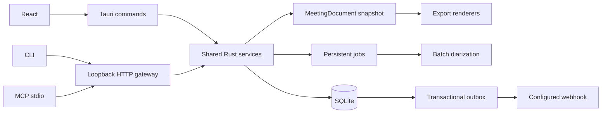

# Meetily 内部增强版落地设计

日期：2026-10-14。源码基线：Community 0.4.1，`a2cb62e`。目标由用户确认：内部自用，覆盖 Pro 核心能力，不做收费授权。本文定义后续实现合同；本次只交付方案和归档清理，本文中的新增接口、表和界面尚未实现。

## 1. 交付范围与决策

保留 Next.js 静态界面、Tauri 2/Rust、SQLite、Whisper/Parakeet、Ollama/内置 LLM/BYOK。新增能力围绕一套领域服务实现，桌面命令、HTTP、CLI、MCP 读取同一份持久化内容。

| 工作包 | 交付 | 现有可复用部分 | 核心缺口 |
|---|---|---|---|
| P0 基础 | 构建基线、共享文档、任务、可靠性 | repositories、录音恢复、摘要来源指纹 | 忽略的 Cargo 配置、事务版本、共享快照、队列和恢复约束 |
| P3 自动化 | 本地只读 API/CLI/MCP；后续写入、录音、Webhook | 当前 Tauri commands、摘要和录音逻辑 | 真正 gateway、权限、共享服务、任务、持久事件 |
| P4 说话人 | 录后/导入/重新转写的批处理分离，试听、改名、合并、纠错 | 保存音频、导入、重新转写、播放时间 | 模型、真实 STT 时间、声纹聚类、版本化结果和人工覆盖 |
| P1 模板 | 六内置模板、完整 CRUD、复制、交换 | JSON schema、loader、提示词生成 | 只有列表和章节预览，无编辑器和写入服务 |
| P2 导出 | 摘要 MD/DOCX/PDF；转写 TXT/DOCX | 复制逻辑、BlockNote、旧格式兼容读取 | 共享文档结构、格式渲染、保存和失败处理 |

官方对比页提供能力分类；录音说话人处理按操作文档的“停止后处理”设计。本文不承诺稳定实时 speaker labels、跨会议身份识别、Pro API 协议完全兼容、企业权限或商业支持。参考：[Pro 对比](https://meetily.ai/pro#pro-comparison)、[分离操作说明](https://docs.meetily.ai/features/speaker-diarization)。

不纳入：支付、试用、License 激活、SSO、多租户、组织模板库、LAN 接入、日历自动入会、内置外部消息发送、向量数据库。旧 license 数据库迁移保留，以兼容存量库；新功能不读取授权状态。

## 2. 执行入口、依赖与排期

| 独立实施计划 | 依赖 | 原工作包人日粗估 | 阶段验收 |
|---|---|---:|---|
| [P0 基础](../plans/2026-10-14-foundation.md) | 当前归档清理 | 3–5 | 干净安装和核心回归；文档、事务、任务合同固定 |
| [P3 自动化](../plans/2026-10-14-automation.md) | P0；现有模板loader；导出接入后置到P2 | 8–12 + 5–8 | 先只读，再写入/录音/事件；导出不阻塞阶段验收 |
| [P4 分离](../plans/2026-10-14-diarization.md) | 探针可先做；集成依赖P0，接入P3接口/事件 | 3–5 + 15–25 | 模型门槛、三入口、人工纠正；不等待P1/P2 |
| [P1 模板](../plans/2026-10-14-templates.md) | P0内容版本；排期在P3/P4后 | 3–5 | 编辑/交换/重启持久化；旧模板兼容 |
| [P2 导出](../plans/2026-10-14-exports.md) | P0文档快照；最后接入P3/P4成果 | 6–10 | 中文文档、原子保存；补齐HTTP/CLI/MCP导出验收 |
| 合计 | macOS 首版 | **43–70** | 内部功能覆盖；效果与打包实测验收 |

1 人日按 8 小时。熟悉 Rust/Tauri/React 的开发者单人约 9–14 个全职开发周；这不是已验证排期。Windows 再预留 8–15 人日，Linux 发行另立范围。

用户调整后的执行顺序：**P0 → P3 → P4 → P1 → P2**。P编号保留为工作包标识，不代表执行优先级。P4的D1模型/时间探针可在P0基线准备后尽早进行，用于提前发现风险；正式产品化仍排在P3之后。P1模板管理和P2文档导出放到最后。

第一阶段先交付“可靠录音/转写 → 助手读取与脚本控制 → 录后说话人分离”；摘要沿用现有模板loader，不等待P1。P3中的导出HTTP路由、CLI export、MCP export_meeting及对应验收移交P2 E3，P3与P4阶段不以DOCX/PDF为验收前置。P4的speaker API与分离完成事件在P4落地时接入已完成的P3。

总量粗估仍为43–70人日；原先20–32/23–38人日的阶段拆分不再适用。导出接入工作随P2验收，阶段人日待P0基线和P4探针校准，不能把全部P3估算直接当作无导出首版用时。每包完成后可单独交付内部安装包。人工数据标注、硬件到位和模型首次下载等待时间不计为已完成开发。

角色：Rust 工程师负责领域服务/SQLite/任务/原生模型，React 工程师负责模板、导出、说话人面板，使用代表负责样本和操作验收；个人开发可兼任，模型质量验收必须有人听音确认。

## 3. 代码边界



新增 `frontend/src-tauri/src/meeting/`（文档/业务服务）、`jobs/`、`export/`、`automation/`、`diarization/`。保持当前 `database/repositories/` 和 `summary/`，逐个把共享业务从 AppHandle 包装层移入 services；不要一次重写巨型 `lib.rs`/`api.rs`。

CLI/MCP 新建根目录 `automation-client/` TypeScript 包，使用 HTTP，不接触 SQLite或音频设备。P0 固定包管理器和锁文件后再加入构建，不把它塞进 Next.js browser bundle。

所有当前会改变会议正文、标题、笔记、摘要、转写、speaker 的命令都要调用共享服务，以免绕过版本更新。Tauri 内部命令不套 HTTP token；HTTP 每次调用都要做权限检查。

## 4. 公共类型与内容合同

公共 DTO 使用 `snake_case`，TS 在 `frontend/src/types/enhancement.ts` 与 `automation-client/src/contracts.ts` 对齐，增加 JSON golden contract 测试。时间以原始录音起点为 0；领域层为 `i64` 毫秒，导入旧 `f64` 秒时显式转换并检测 NaN/负数/逆序。旧库无时间字段保留 `null`。

```rust
pub struct SourceVersions {
    pub revision: i64,             // 会议内容总版本，事务递增
    pub transcript_revision: i64,
    pub speaker_revision: i64,
    pub summary_revision: i64,
    pub notes_revision: i64,
}
pub struct DocumentSegment {
    pub id: String,
    pub text: String,
    pub start_ms: Option<i64>,
    pub end_ms: Option<i64>,
    pub speaker_id: Option<String>,
    pub speaker_name: Option<String>,
    pub assignment: String,        // unknown/model/manual/overlap
}
pub struct MeetingDocument {
    pub schema_version: u32,       // 首版 1
    pub meeting_id: String,
    pub title: String,
    pub created_at: String,        // UTC RFC3339
    pub versions: SourceVersions,
    pub summary_markdown: Option<String>,
    pub notes_markdown: Option<String>,
    pub transcript: Vec<DocumentSegment>,
    pub summary_stale: bool,
}
pub struct Page<T> {
    pub items: Vec<T>,
    pub next_cursor: Option<String>,
}
pub enum DocumentKind { Summary, Transcript }
pub enum ExportFormat { Md, Txt, Docx, Pdf }
pub struct ExportRequest {
    pub meeting_id: String,
    pub kind: DocumentKind,
    pub format: ExportFormat,
    pub expected_revision: Option<i64>,
    pub include_notes: bool,       // 默认 false
}
```

API 列表不返回全量 `MeetingDocument`。`Page<T> { items: Vec<T>, next_cursor: Option<String> }`，默认 50/最大 200，用 `(created_at,id)` 稳定游标。全文转写用 `(start_ms,id)`，无时间旧记录固定放末尾按 timestamp/id 排序。

服务公共错误 `EnhancementError { code: String, message: String }`：`NOT_FOUND`、`INVALID_INPUT`、`CONFLICT`、`NO_AUDIO`、`NOT_READY`、`BUSY`、`CANCELLED`、`IO_ERROR`、`PROVIDER_ERROR`。HTTP 包装另加 `UNAUTHORIZED`/`FORBIDDEN`/`RATE_LIMITED`；业务错误不暴露私有绝对路径、token、key 或整段转写。

### 快照与未保存内容

`MeetingDocumentService::snapshot(meeting_id: &str) -> Result<MeetingDocument, EnhancementError>` 在一致性读取事务内读完所有分页，绑定版本；不读取 UI 可视区，也不混入未提交内容。Rust `meeting/normalize.rs` 将历史摘要 JSON/markdown 转成 canonical markdown。

当前 BlockNote 的编辑内容仍可能只在前端：桌面导出默认先等待保存成功，再取快照。用户取消保存就取消导出；保存失败不得悄悄导出旧版。CLI/MCP 明确只读已保存版本。`save_summary_markdown(meeting_id, markdown, expected_revision)` 同步规范化持久化和现有编辑器内容，前端改用统一保存入口。notes 同理，不能改变现有 JSON 编辑器内容字段的语义。

### 摘要来源

保留已有缓存指纹，增加 speaker 名称/覆盖有效内容和版本。生成任务启动即冻结转写、姓名、模板内容、prompt、provider/model、语言；提交前比较来源版本，不用生成期间新改的人名拼接旧推理结果。过期结果保留为历史/备份并标记 `summary_stale`，不自动发起可能收费的再生成。

各 provider 统一 token budget：扣除 system/template/output 预算，按段/turn 切块再归并；优先 provider tokenizer，未知 provider 使用可配置保守估计。中文 token 用实际样本校准，不能只沿用字符数乘 0.35。

## 5. 数据迁移合同

下面是**计划新增**迁移，不属于本次清理。已有 10 个迁移不可编辑、重排或删除，即使名称带 license/backup/speaker。SQLx migration checksum 要保持。尚未实现的模板偏好迁移编号改为20261014000600，排在自动化和分离迁移之后，避免最后实现P1时向已升级版本中补插更早迁移；这不改任何已发布迁移。

| 新迁移建议名 | 表与关键列 | 行为 |
|---|---|---|
| `20261014000100_add_content_versions.sql` | `meeting_content_versions(meeting_id PK/FK, revision, transcript_revision, speaker_revision, summary_revision, notes_revision)`；各版本 INTEGER NOT NULL DEFAULT 0；`meeting_document_content(meeting_id PK/FK, summary_markdown, notes_markdown)` | 插入存量 meeting；新 meeting 同事务初始化；正文/命名变更同事务更新，增量只在服务入口做；canonical内容不覆盖原编辑器JSON，首次保存才回写 |
| `20261014000200_add_enhancement_jobs.sql` | `enhancement_jobs(id PK, meeting_id FK, kind, status, source_revision, params_json, progress, error_code, created_at, updated_at)` | meeting 删除 cascade；status 限定 queued/running/succeeded/failed/cancelled/interrupted |
| `20261014000400_add_automation.sql` | `automation_clients(id PK,name,token_hash,scopes_json,expires_at,revoked_at)`；`automation_webhooks(id PK,url,secret_ref,enabled)`；`automation_events(id PK,meeting_id,kind,revision,payload_json,created_at)`；`automation_deliveries(event_id,webhook_id,attempts,next_attempt_at,status,last_http_status, PK(event_id,webhook_id))` | token 只存 hash，Webhook secret 只存系统密钥库引用；每个事件每订阅独立投递；事件不 cascade，以支持删除通知/审计，但无全文正文 |
| `20261014000450_add_transcript_timing.sql` | `transcripts.timing_precision TEXT NOT NULL DEFAULT 'approximate'`，允许 exact/approximate/unavailable | D2增加；旧有时间按approximate，无时间读为unavailable，不伪造精确性 |
| `20261014000500_add_diarization.sql` | 见下面六表 | 分离结果和人工修正分开；活动结果由 meeting 状态指向 |
| `20261014000600_add_template_preferences.sql` | `meeting_template_preferences(meeting_id PK/FK, template_id, template_hash)` | 未选择时用当前默认模板；不回写历史摘要 |

分离六表：

- `diarization_runs(id PK,meeting_id FK,job_id FK,source_transcript_revision,audio_sha256,model_id,params_json,status,created_at)`。
- `meeting_speakers(id PK,meeting_id FK,display_name,merged_into NULL FK,created_at)`。ID 为 UUID，仅会议内稳定；同名不合并。
- `speaker_turns(id PK,run_id FK,speaker_id FK,start_ms,end_ms,score NULL)`。CHECK `0 <= start_ms < end_ms`，保留重叠 turns。
- `segment_speaker_assignments(run_id FK,segment_id FK,speaker_id NULL FK,method, PK(run_id,segment_id))`。无法准确归属留 NULL。
- `speaker_overrides(segment_id PK/FK,speaker_id FK,transcript_revision,updated_at)`。人工覆盖独立于模型结果。
- `meeting_diarization_state(meeting_id PK/FK,active_run_id NULL FK,expected_speakers NULL)`。期望人数可空，提供时 1–10。

所有 speaker/segment/run 外键关系在事务内验证属于同一 meeting。合并 speaker 禁止环，解析到最终 speaker 后统一展示。索引：jobs(status,created_at)、turns(run_id,start_ms)、events(created_at)、deliveries(status,next_attempt_at)。

SQLite 与文件无跨资源事务：模板先临时文件 fsync→rename，再更新选择引用；失败恢复不删除旧模板。迁移前用 SQLite online backup 得到一致性备份，带 WAL 的运行中数据库不能直接只复制 `.db`。应用级别恢复须先停写/关闭连接，再保存 DB/WAL/SHM 原样副本；不自动删 WAL 换取启动。

版本升级保留旧字段可读，不支持旧二进制继续写增强后的库。回退用升级前备份和旧安装包一起恢复，界面导出快照可额外保留作人工恢复材料。

## 6. P1 模板产品与接口

首版沿用现有 JSON `Template {name,description,sections}` 和三个 format：`paragraph|list|string`；编辑器按章节显示完整 instruction/item_format。六内置模板只读，复制为自定义后编辑。JSON 是首版完整交换格式，Markdown 完整可逆交换单列后续需求，避免把结构预览当可编辑提示词。

`TemplateRecord { id, origin: builtin|custom, revision: SHA256, content: Template }`。内置 ID 不变；新 custom ID 固定 `custom_` + UUID，不用名称作文件名。保存/删除携带 expected_revision；限制 128 KiB/文件、64 sections，拒绝 `/`、`..`、符号链接越界与非法 format。

新增 `TemplateService::{list,get,create,update,duplicate,delete,import_json,export_json}`；桌面 commands：`api_get_template`、`api_create_template`、`api_update_template`、`api_duplicate_template`、`api_delete_template`、`api_import_template`、`api_export_template`；保留旧 list/details 接口包装。

继续采用 loader 实际计算的 `dirs::data_dir()/Meetily/templates`，不要依据注释猜 Linux 路径。支持注入测试目录。旧自定义文件与内置同 ID 时：先展示为 legacy override，保留当前读取含义，禁止直接编辑原文件；内置预览从bundled/embedded来源明确读取。迁移时保留原文件备份，导入为custom ID，更新旧选择引用，然后将原覆盖文件移到backup子目录；每一步有迁移journal可恢复。用户点击迁移后实施，不静默覆盖用户文件。迁移前不声称同ID的旧选择就是原内置内容。

删除已选模板要求先指定替代模板并事务更新引用；旧摘要不变。编辑模板只影响下次生成。模板管理入口放摘要设置；会议详情可选择并预览。所有功能无 Pro gate。

## 7. P2 导出产品与接口

格式矩阵固定：summary→MD/DOCX/PDF；transcript→TXT/DOCX；无摘要时 summary 导出返回 NOT_READY，转写仍可导出。笔记默认不混入摘要，ExportDialog 提供单独“附带笔记”选项，`include_notes` 默认 false。

`ExportService::render(request: ExportRequest) -> Result<ExportArtifact, EnhancementError>`，`ExportArtifact { id, mime_type, filename, size_bytes, source_revision }`。内部私有缓存文件不要放 DTO 中；另有 `save_artifact(artifact_id, selected_path)` 仅桌面保存命令可用。API 下载绑定创建客户端，15 分钟过期；read 权限允许生成受限私有缓存，不允许指定任意系统路径。

推荐 DOCX 使用 [docx-rs](https://github.com/bokuweb/docx-rs)；PDF 先探针验证打包 [Typst](https://typst.app/docs/) CLI sidecar + 有再分发许可的中文字体。不依赖用户安装 Word/LibreOffice。仅本地运行；正文作为结构化字符串写入受控模板，禁网络、禁用户正文执行 Typst 指令、禁读取任意文件。探针记录二进制/字体版本、许可、哈希、安装包增量；若选型门槛失败，单独修订 PDF 工作包，其他格式继续交付。

renderer 共用 document blocks（标题、段落、列表、表格、代码、链接），禁加载远程图片；不支持的 BlockNote 元素转换为明确占位和 warning，不静默漏内容。PDF A4、内边距 20mm、中文正文字体 10.5pt，表格长行和跨页重复表头、标题孤行、长 URL 有固定样例。

输出为同目录临时文件，写完关闭后 rename，覆盖已有文件须确认；失败保留原文件并删除临时文件。文件名去路径分隔符、Windows 保留名、控制字符，限制 120 字符。完成提示显示导出源版本与输出位置，允许打开所在目录。

## 8. P3 本地自动化合同

新增 automation 设置默认关闭；启动绑定 `127.0.0.1` 随机空闲端口，选配 `::1` 要保持同权限，禁止 `0.0.0.0`。endpoint discovery 文件用系统 app data 子目录，仅当前用户可读写，内容只含 pid/instance_id/base_url/protocol_version，不含 token。关闭后清理文件；客户端用 instance_id 验证过期记录。

每个客户端通过桌面创建 256-bit 随机 Bearer token，只展示一次；服务端存 SHA256，恒定时间比较；到期/撤销每次查询检查。scopes 首版 `read`；后续 `write`、`record` 独立授权。read 不包含原始音频下载或密钥。首版read授权覆盖当前用户的全部会议，界面必须显示该授权范围，不做单会议ACL。授权不是收费 License。

P3首版不注册导出路由/CLI命令/MCP工具，`/health.capabilities`中不包含export；客户端只展示实际已实现且授权可用的工具，不将不存在的导出包装成成功。P1前summary-jobs直接读取现有模板loader并冻结内容，不依赖模板管理CRUD/偏好表。

首版 gateway 建议 axum；锁定版本由 P0 Cargo/toolchain 探针产出。协议 namespace `/api/internal/v1`，不仿冒 `meetily-pro` CLI：

| HTTP | scope | 请求与响应 |
|---|---|---|
| `GET /health` | 无；仅 loopback | protocol_version/instance_id/capabilities，仅服务状态及已实现功能名 |
| `GET /meetings?limit=&cursor=` | read | Page<MeetingBrief>：id/title/created_at/revision |
| `GET /search?q=&limit=&cursor=` | read | Page<SearchHit>：meeting_id/segment_id/start_ms/snippet；q 1–256 字符，snippet≤300 字符 |
| `GET /meetings/:id/transcript` | read | Page<DocumentSegment> + revision |
| `GET /meetings/:id/summary` | read | markdown/source_revision/stale |
| `POST /exports` | read | P2 E3后开放：ExportRequest → 202 {job_id} |
| `GET /jobs/:id` | read | JobSnapshot；read可看会议处理状态，export artifact下载另校验创建客户端 |
| `GET /exports/:artifact_id/download` | read | P2 E3后开放：attachment stream；只允许本客户端 artifact |
| `POST /meetings/:id/summary-jobs` | write | template_id/expected_revision → 202 {job_id}；允许调用已配置 provider，不返回 key |
| `POST /jobs/:id/cancel` | write | 幂等取消；录音任务另须 record |
| `PATCH /meetings/:id/speakers/:speaker_id` | write | display_name/expected_revision → 新 revision；P4 完成后开放 |
| `POST /recordings` | record | meeting_title/device IDs/idempotency key → session_id；与 UI 同一状态机 |
| `POST /recordings/:session_id/stop` | record | 幂等停止，校验 session，不能误停刚开始的新会 |

响应错误 `{error:{code,message},request_id}`；401/403/404/409/422/429/503 与状态对应。max body 1 MiB；每 token 60请求/分钟；CPU/GPU重任务（分离/摘要/导出）全局 1 个；等待队列最多 16；分页只读并发 4；Webhook IO投递由独立并发1的dispatcher执行；export cache 总上限 256MiB，单 artifact 64MiB，超额返回 BUSY。Origin 非空且不是允许的本地 desktop origin 时拒绝；Host 限精确 loopback+当前端口，避免本地浏览器/DNS rebinding 绕过。

CLI首版 `meetily-internal list|search|transcript|summary|job`，P3写入阶段增加 `summarize|record start|record stop`，P2 E3再增加 `export`；成功 JSON 输出可选 `--json`，错误 stderr，退出码 0成功/2参数/3未连接/4未授权/5业务失败/6取消。token 来自 OS keychain 或显式环境变量，禁止出现在 argv/discovery/log。

MCP首版五个只读tools使用同一DTO：`list_meetings`、`search_meetings`、`get_transcript`、`get_summary`、`get_job`；P2 E3后增加 `export_meeting`。stdout 只写协议，stderr 诊断；工具分页、返回有限内容。外部会议文字是数据，不作为工具执行指令；不提供 shell、任意文件读写、会议删除。首版手动连接一个内部实际使用的助手。

### 写入、录音与事件

写请求带 `expected_revision`；不匹配409。摘要和录音启动用 `Idempotency-Key`；另增 `automation_requests(client_id,key,request_hash,response_json,expires_at, PK(client_id,key))` 在 automation 迁移，同 key+不同 body 拒绝409，保留24小时；请求记录不存 token/正文，摘要 params 为模板/provider引用。

Webhook 首版事件：`recording.stopped`、`transcript.completed`、`diarization.completed`、`summary.completed`、`summary.failed`。`recording.stopped` 表示录音文件持久化，不表示转写完成。业务提交与 events 插入同事务；每个已启用 webhook 建独立 deliveries。`summary.failed` 的任务终态也在事务内提交。

payload：event_id/meeting_id/kind/revision/job_id/occurred_at，无正文。HMAC-SHA256 对 `timestamp + '.' + raw_body` 签名，事件 ID 重试不变，投递时间和签名每次刷新。超时10秒；初次加5次重试间隔10秒/1分钟/5分钟/30分钟/2小时；2xx成功，429/5xx/网络错误重试，其他4xx终止；最大响应体16KiB，不记响应正文。关闭订阅停止后续投递；每个接收端自行按 event_id 去重。

目标只由桌面配置，默认 HTTPS；测试仅允许显式 localhost 目标。内网接收端按精确域名/IP allowlist 配置，禁止 link-local/metadata，多地址 DNS逐一验证并固定连接地址，禁止重定向；无第三方默认发送。参考：[官方鉴权](https://docs.meetily.ai/developers/authentication)、[官方事件](https://docs.meetily.ai/developers/webhooks-and-sse)。

## 9. P4 分离、时间与人工纠正合同

先做 3–5 人日选型：优先 [sherpa-onnx](https://k2-fsa.github.io/sherpa/onnx/speaker-diarization/index.html) 本地 Rust/C API；若质量不达标，比较 [pyannote community-1](https://huggingface.co/pyannote/speaker-diarization-community-1) 独立本地 sidecar。框架、模型权重、首次授权下载条件分别核验，不把已删除 FastAPI 恢复为新依赖。

探针必须记录内部目标机器 OS/CPU/GPU/RAM、模型与运行时哈希、处理时长、峰值内存、安装包增量。建议内部 Go 门槛：普通中文2–6人样本说话人错误率 DER≤20%（250ms collar，overlap 单列）、60分钟录音 RTF≤0.5、分离进程峰值RSS≤2GiB、取消≤3秒响应。门槛是本项目建议目标，非候选已实现效果；依样本/硬件形成选型记录后才冻结全量排期。质量失败但性能通过不算 Go。

样本集至少10段、累计≥90分钟：普通话、中文夹英语、远程压缩、噪声、单人、2–6人、短应答、明显交叠；另用一份120分钟会议测长时内存。人工标注 turn 边界与speaker，20%不参与调参；模型下载与真样本不提交 Git。

时间链路是关键前置：当前 TranscriptResult 只有整段 text，不能用字符长度比例拆时间。扩展 `TimedText { text,start_ms,end_ms }`、`TimingPrecision { Exact, Approximate, Unavailable }` 和结果 `timed_segments`。Whisper先读引擎段/词时间，验证打开 timestamps 不重现已有漏字；Parakeet无法给出真时间时保持 unavailable，或在探针通过后增加 forced alignment，不假装精确。

STT返回的TimedText时间首先相对于该次输入音频，worker经time_map映射后才写入原录音时间。`SourceSpan { start_sample: u64, end_sample: u64 }` 为映射后的原音频区间。VAD 拼接音频必须携带 `TimeMapSpan { packed_start_sample: u64, source_start_sample: u64, sample_count: u64 }`，把 STT 时间映射回原录音；跨非连续区间的 segment 拆为有证据的 spans。导入、重新转写和录音使用同一 mapping 实现；重采样由 sample index 换算，不累计墙钟差。

`DiarizationService::enqueue(meeting_id: &str, expected_speakers: Option<u8>) -> Result<JobSnapshot, EnhancementError>` 在转写完成+音频写完后触发。`DiarizationEngine::run(audio_path, options, cancellation)` 只输出带原音频时间的 turns/cluster labels；不接触 SQLite，按窗口处理防止整段 PCM 无限驻留。

归属算法：计算 segment/turn 的交集，最佳speaker占 segment 时长≥0.6、领先第二名≥0.2且时间可信，才标 model；明显交叠标 overlap，其他 unknown。阈值先以样本验证，修改必须更新算法版本。没有可信子句时间时保留整段 unknown，人工允许指定整段归属；不用 LLM 猜人名。

模型 rerun 在 staging run 写结果，成功且 source revision/audio hash仍一致才切 active_run；失败/取消保留旧结果。重跑有人工纠正时先展示影响：默认保护同一 transcript revision 的 overrides；想清空必须显式确认。新 run 的 clusters 与旧speaker按时间交集匹配，高置信度才复用 ID，歧义保留未命名的新speaker，不能错误继承姓名。

重新转写会换正文/segment IDs：先备份旧结果并明确提醒姓名修正可能失效，再在事务内提交新文本与新分离；失败保留旧文本与归属。禁止混用不同 transcript revision 的覆盖。对同一文本重跑分离永远不改 words。

UI Speakers 面板：查看人数和状态、播放每人5–10秒代表片段、改名、合并、段落重新指定、期望人数、重跑、取消。名字仅会议内有效。无保存音频显示原因与开启保存入口；关闭分离后旧 labels 可读。摘要提示“说话人修改后内容已过期”，由用户选择重生成。

## 10. 可靠性与发布门槛

Jobs DTO：`JobSnapshot { id,meeting_id,kind,status,progress,error_code,source_revision }`。queued→running→succeeded/failed/cancelled；异常退出留下 running，下次启动改 interrupted，用户重试，不自动重复收费请求。cancel token透传到 renderer/模型/HTTP；只有结果事务提交完成才出现 succeeded。

调度：分离/导出/摘要重任务全局1个，录音优先。录音开始时暂停可暂停的低优先任务；不能暂停则禁止新重任务，界面说明。实时采集回调不可阻塞：持续保存原始音频，转写队列改有界上限，溢出记录待补转写区间；停录后从保存音频补处理，禁止静默丢字或无限内存堆积。

发布验证：

1. 干净 checkout安装锁定依赖→frontend typecheck/build→Rust单测→Tauri构建→启动包内 llama-helper/FFmpeg（PDF另有sidecar）；CPU路径+macOS Metal分别验证。
2. 旧库升级，带WAL恢复、磁盘满、只读目录、强制退出后重启；不损坏最后可读会议。
3. P0/P4用一份120分钟会议验证转写完整计数、峰值RSS和积压恢复，设备断开/切换和取消后继续录音；导出末行完整和中文字体检查在P2追加，不阻塞P3/P4。
4. gateway默认关闭/无效凭据/越scope/撤销/实例退出；MCP实际连接并定位一段会议证据；不泄露key和完整诊断正文。
5. 分离Go记录、三入口、改名/合并/覆盖、rerun/retranscribe、摘要过期和各出口一致。

每阶段安装包附 release notes、版本、migration backup位置、回退安装包、可复现命令和实测报告。源码测试、安装包启动和使用验收分别记录；仅 metadata 或 HTTP200不能替代运行验收。

## 11. 本次已执行范围

已清理历史 Python/Docker/Whisper服务器、孤立Rust原型、旧脚本和未引用安装器，保留音频测试样例及许可证。具体备份、61个跟踪路径清单、验证结果、仍活动的兼容代码见 [清理记录](../../ARCHIVE_CLEANUP_2026-10-14.md)。本次未新增schema、HTTP监听、模型或收费授权逻辑。
